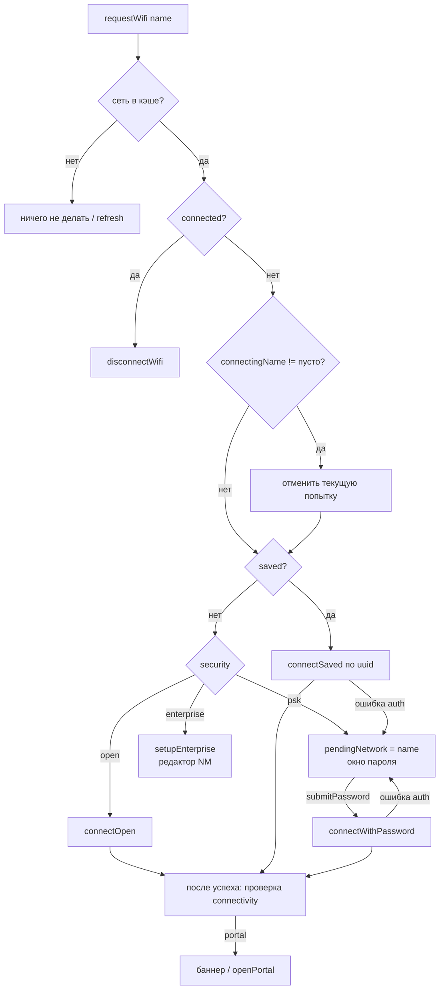

# Internet: руководство по реализации backend

> ## Статус реализации (в этой оболочке)
>
> Руководство реализовано в `quickshell/singletons/NetworkService.qml`
> (singleton, прописан в `quickshell/singletons/qmldir`). Имена публичного
> API совпадают с разделом 1, фронт (`PanelInternet.qml`, `WifiRow.qml`,
> `PasswordDialog.qml`, плитка Internet) переведён на сервис, `MockState`
> больше не содержит сети.
>
> Что сделано: чтение состояния и разбор terse-вывода nmcli (разделы 4–5),
> scan с очередью и защитой по времени (6), включатель radio (7), дерево
> решений `requestWifi` с синхронным `pendingNetwork` (8–11), классификация
> ошибок (12), Ethernet со скоростью и default route (16), события
> `nmcli monitor` + `nmcli device monitor` + редкая страховка radio (17),
> синхронизация `ListModel` по ключу (18), captive portal (14, баннер
> `PortalBanner.qml`), enterprise через скелет профиля и редактор NM (13).
>
> **Отличия от руководства, проверенные на этой системе** (nmcli 1.58.1,
> NetworkManager, Quickshell 0.3.2):
>
> 1. **Пароль передаётся через файл секретов, а не `--ask`/stdin.** Здесь
>    `--ask` без TTY не получает пароль и зацикливается на повторных
>    запросах, позиционный `password <psk>` в 1.58 больше не принимается.
>    Поэтому профиль создаётся сам (`connection add` без ключа), а пароль
>    уходит в NM как `connection up ... passwd-file`: секрет не попадает в
>    argv, TTY не нужен. Файл лежит в `$XDG_RUNTIME_DIR`, создаётся с
>    `umask 077` и удаляется сразу после попытки.
> 2. **Нативный модуль `Quickshell.Networking` для пароля больше не
>    используется.** У него собственный список сетей и собственный скан, и
>    когда сети в этом списке не было, подключение обрывалось ошибкой «сеть
>    вне зоны», хотя сеть видна и пароль верный. Профильный путь от списка
>    модуля не зависит.
> 3. **`nmcli monitor` не сообщает о внешнем `radio wifi off`** (проверено:
>    в выводе нет событий устройства). Добавлены `nmcli device monitor` и
>    опрос `nmcli radio` раз в 4 секунды — иначе Fn-клавиша и rfkill не
>    были бы видны в UI. Мониторы перезапускаются при завершении (17.1).
>    Опрос — только radio; списки, как и в руководстве, обновляются
>    событиями, а пока панель открыта — дешёвым `--rescan no` раз в 5 с.
> 4. **`strength` — уровень для иконки.** Делегат `PanelIcon` ждёт 0–4,
>    поэтому сервис отдаёт уже переведённое значение
>    (`round(SIGNAL/25)`), а не 0–100.
>
> Есть сверх руководства: контекстное меню сохранённой сети по правому
> клику (`NetworkContextMenu.qml`) — «Change password» и «Forget network»
> с подтверждением; в диалоге пароля — глазок для просмотра пароля.
> Меню живёт **внутри окна панели быстрых настроек** (тот же `PopupWindow`):
> отдельная layer-shell поверхность оказывалась под панелью, потому что
> попап рисуется поверх слоёв. Для меню окно панели подрастает вниз, карточка
> кладётся по координатам клика внутри окна, клик мимо закрывает меню.
> Вид и оба режима (пункты и подтверждение удаления) проверены скриншотами.
>
> Чего пока нет: скрытых сетей, выбора Wi-Fi адаптера и собственного
> диалога enterprise (редактор NM открывается как внешний процесс; его
> наличие в системе не проверяется). Модуль enterprise не проверялся
> живьём: в системе нет `nm-connection-editor`. **Контекстное меню пока не
> проверено визуально**: логика (открытие, подтверждение, удаление, смена
> пароля) работает и проверена через IPC, но позиционирование попапа под
> layer-shell нужно посмотреть глазами.
>
> Как проверялось: `rt/verify-net.sh` — поднимает отдельный экземпляр
> оболочки, гоняет сценарии через `qs ipc`, снимает скриншоты в `rt/`.
> Живьём подтверждены: список сетей и разделение Saved/Available,
> выключение/включение radio (в том числе снаружи), диалог пароля,
> «неверный пароль» с сохранением диалога, отсутствие «битого» профиля
> после неудачи и после отмены, `connectivity`, состояние Ethernet-строки.

Документ описывает, как заменить `MockState` настоящим backend'ом для панели «Internet» (`PanelInternet.qml`, `WifiRow.qml`) в оболочке на Quickshell. Backend строится поверх **NetworkManager (NM)**: он сам держит профили, ключи, DHCP, роутинг и автоподключение. Наша задача — тонкий слой, который читает состояние NM, отдаёт его фронту и переводит действия пользователя в команды.

Содержание:

1. [Что требует фронт (контракт)](#1-что-требует-фронт-контракт)
2. [Выбор способа общения с NM](#2-выбор-способа-общения-с-nm)
3. [Архитектура сервиса](#3-архитектура-сервиса)
4. [Окружение и права](#4-окружение-и-права)
5. [Чтение состояния и парсинг](#5-чтение-состояния-и-парсинг)
6. [Поиск сетей (scan)](#6-поиск-сетей-scan)
7. [Включатель Wi-Fi](#7-включатель-wi-fi)
8. [Клик по сети: дерево решений](#8-клик-по-сети-дерево-решений)
9. [Сохранённые сети](#9-сохранённые-сети)
10. [Открытые сети](#10-открытые-сети)
11. [Сети с паролем (PSK/SAE) и окно ввода](#11-сети-с-паролем-pskсае-и-окно-ввода)
12. [Неверный пароль и другие ошибки](#12-неверный-пароль-и-другие-ошибки)
13. [Enterprise-сети (сертификаты, 802.1X)](#13-enterprise-сети-сертификаты-8021x)
14. [Captive portal (страница входа)](#14-captive-portal-страница-входа)
15. [Отключение от сети](#15-отключение-от-сети)
16. [Ethernet и другие проводные соединения](#16-ethernet-и-другие-проводные-соединения)
17. [События и обновление данных](#17-события-и-обновление-данных)
18. [Обновление списков без мерцания](#18-обновление-списков-без-мерцания)
19. [Безопасность](#19-безопасность)
20. [Граничные случаи](#20-граничные-случаи)
21. [Чек-лист тестирования](#21-чек-лист-тестирования)
22. [План внедрения](#22-план-внедрения)
23. [Приложение: каркас `NetworkService.qml`](#23-приложение-каркас-networkserviceqml)

---

## 1. Что требует фронт (контракт)

Всё ниже выведено из двух присланных файлов. Новый сервис должен предоставить **те же имена**, чтобы замена `MockState` → `NetworkService` свелась к переименованию.

### 1.1. Свойства

| Свойство | Тип | Где используется | Смысл |
|---|---|---|---|
| `wifiEnabled` | bool | заголовок, заглушка `PanelDisabled`, видимость списков | Программный Wi-Fi radio включён |
| `wifiScanning` | bool | `PanelHeader.refreshing` | Идёт поиск сетей (крутится индикатор) |
| `ethernetConnected` | bool | высота/видимость строки Ethernet | Есть проводное соединение, которое надо показать |
| `internetViaEthernet` | bool | иконка `connected`, текст справа | Именно провод — основной канал в интернет |
| `ethernetName` | string | текст строки | Имя соединения/интерфейса |
| `ethernetSpeed` | string | текст справа | Например `1 Gbit/s`; показывается только если `internetViaEthernet` |
| `savedWifiNetworks` | model | секция «Saved» | Сохранённые сети |
| `wifiNetworks` | model | секция «Available» | Остальные доступные сети |
| `pendingNetwork` | string | проверка после `requestWifi` | Имя сети, для которой нужен ввод пароля; `""` если не нужен |

### 1.2. Методы

| Метод | Кто вызывает | Что делает |
|---|---|---|
| `scanWifi()` | открытие панели, кнопка refresh, включение Wi-Fi | Запускает поиск |
| `toggleWifi()` | переключатель, кнопка «Turn on» | Вкл/выкл radio |
| `requestWifi(name)` | клик по строке | Единая точка входа для «подключиться/отключиться/запросить пароль» |

### 1.3. Роли модели (обязательные поля делегата `WifiRow`)

```
name:       string   // SSID
strength:   int      // уровень сигнала (см. примечание)
security:   string   // "open" | "psk" | "enterprise"
saved:      bool     // для сети есть профиль NM
connected:  bool     // активна прямо сейчас
connecting: bool     // идёт подключение (крутится LoadingIndicator, строка не кликается)
```

Примечание про `strength`: nmcli отдаёт `SIGNAL` в диапазоне 0–100. Посмотрите, что ждёт `PanelIcon` (0–100 или 0–3/0–4), и при необходимости переведите в сервисе. Внутренние дополнительные поля (`uuid`, `bssid`, `device`) в модель класть можно, но они не обязаны быть `required` в делегате.

### 1.4. Критичная особенность: `requestWifi` + `pendingNetwork`

```qml
onActivated: {
    UiState.dialogScreen = UiState.openedScreen;
    MockState.requestWifi(name);
    if (MockState.pendingNetwork !== "")   // ← проверяется СРАЗУ, синхронно
        UiState.close();
}
```

Из этого следует три жёстких правила:

1. **`requestWifi` обязан установить `pendingNetwork` синхронно**, до любых асинхронных вызовов, опираясь только на кэш (`security`, `saved`, `connected`). Ждать ответа `nmcli` нельзя — панель к тому моменту уже не закроется (или закроется не тогда).
2. Если пароль не нужен (сохранённая, открытая, enterprise с готовым профилем, отключение) — `pendingNetwork` остаётся `""`, панель остаётся открытой, строка показывает `connecting`.
3. Окно ввода пароля не должно открываться «от клика». Оно должно **реагировать на изменение `pendingNetwork`**, потому что пароль может понадобиться и позже, асинхронно: у сохранённой сети, например, мог измениться пароль на роутере, и ошибка аутентификации придёт через несколько секунд (см. раздел 12).

### 1.5. Чего не хватает во фронте (нужно добавить)

Окно пароля в присланных файлах отсутствует, поэтому его API определяет backend. Минимально необходимо:

| Элемент | Тип | Назначение |
|---|---|---|
| `submitPassword(password)` | метод | Окно вызывает при Enter/«Connect» |
| `cancelPending()` | метод | Кнопка «Cancel»/Esc: сбросить `pendingNetwork`, прервать попытку |
| `connectError` | string | `""`, `"auth"`, `"timeout"`, `"dhcp"`, `"notfound"`, `"other"` — окно показывает «Неверный пароль» и т. п. |
| `connectErrorText` | string | Сырой/человекочитаемый текст для логов и подсказки |
| `connectingName` | string | Имя сети, к которой идёт подключение (из него вычисляется `connecting` в моделях и состояние кнопки в диалоге) |
| `connectivity` | string | `"full"`, `"portal"`, `"limited"`, `"none"`, `"unknown"` — для баннера captive portal |
| `wifiHardBlocked` | bool | Wi-Fi заблокирован аппаратным переключателем; `PanelDisabled.description` меняется на «Disabled by hardware switch» |
| `openPortal()` | метод | Кнопка «Sign in to network» |

Необязательные, но желательные: клик по строке Ethernet (подключить/отключить), пункт «Forget» для сохранённых сетей. Описаны в разделах 9 и 16.

---

## 2. Выбор способа общения с NM

### Вариант A — `nmcli` через `Quickshell.Io.Process` (рекомендуется для старта)

- Есть везде, где есть NM, не зависит от версии Quickshell.
- Умеет всё нужное: radio, scan, список, профили, подключение, пароль, `nmcli monitor`, connectivity.
- Минус: текстовый парсинг, нужен контроль локали и экранирования; секреты нельзя передавать через argv без утечки в `ps` (см. раздел 19).

Именно на нём построено остальное руководство.

### Вариант B — `Quickshell.Networking` (нативный модуль)

В свежих версиях Quickshell есть модуль `Quickshell.Networking` с NM-бэкендом поверх D-Bus: объекты устройств и сетей, сигнал, состояние, `connect()`/`disconnect()`/`forget()`. Плюс — реактивность без парсинга и без polling. Минусы, которые надо проверить **по документации вашей версии**: передача пароля, enterprise, captive portal, скорость Ethernet, причины сбоя. Если пароль и причины ошибок в вашей версии поддерживаются — модуль можно взять для списка сетей и состояния, а `nmcli` оставить для недостающего. Логика из разделов 8–16 от выбора не зависит.

### Вариант C — прямой D-Bus (`busctl`/`gdbus`)

Нужен только для того, что `nmcli` не умеет красиво (свой secret agent, `ConnectivityCheckUri`). Свой secret agent — тема отдельная и сложная; на первом этапе не нужен.

---

## 3. Архитектура сервиса

Один синглтон `NetworkService.qml` (`pragma Singleton`), внутри пять слоёв:

```
┌────────────────────────────────────────────────────────────┐
│ Публичный API (совместим с MockState)                      │
│  свойства / модели / requestWifi / toggleWifi / scanWifi   │
├────────────────────────────────────────────────────────────┤
│ Действия (actions): connectSaved, connectOpen, connectPsk, │
│ setupEnterprise, disconnect, ethernet*, openPortal         │
├────────────────────────────────────────────────────────────┤
│ Состояние (state): кэш сетей, профили, устройства,         │
│ connectingName, pendingNetwork, connectError               │
├────────────────────────────────────────────────────────────┤
│ Парсеры: splitTerse, mapSecurity, mapDeviceState, ...      │
├────────────────────────────────────────────────────────────┤
│ Runner: run(args, cb, stdin) + очередь мутирующих команд   │
│ Monitor: постоянный `nmcli monitor` → debounce → refresh() │
└────────────────────────────────────────────────────────────┘
```

Правила:

- **Читающие** команды (`list`, `show`) можно запускать параллельно.
- **Мутирующие** (`radio`, `connect`, `up`, `down`, `delete`) идут через **очередь по одной**. Это важно: фронт при включении делает `toggleWifi(); scanWifi();` подряд, и `scan` не должен стартовать раньше, чем radio реально включился.
- Новый запрос на подключение отменяет предыдущий (убить процесс `nmcli`, `connectingName` перезаписать).
- Источник истины — NM. Сервис не хранит «желаемое» состояние дольше, чем нужно для оптимистичного UI, и после каждого действия делает `refresh()`.
- Оптимистичные обновления допустимы для мгновенного отклика (переключатель, `connecting`), но обязательно подтверждаются/откатываются по факту.

---

## 4. Окружение и права

1. **Локаль.** Все вызовы `nmcli` с `LC_ALL=C` (`Process.environment`). Иначе тексты ошибок и значения (`connected`/«подключено») зависят от языка системы, а классификация ошибок по подстрокам ломается.
2. **Формат.** Всегда `-t` (terse), явный `-f` со списком полей, никакого разбора таблиц по пробелам.
3. **Polkit.** Операции NM (`radio wifi on`, подключение, создание профиля) разрешены пользователю **активной локальной сессии**. Если композитор запущен «странно» (например, из systemd-юнита без logind-сессии), `nmcli` вернёт `Insufficient privileges` / `not authorized`. Проверка: `nmcli radio wifi on` из терминала внутри сессии. Эту ошибку сервис должен отличать (`connectError = "other"`, текст в лог).
4. **Не запускайте параллельно других secret agent'ов** (`nm-applet`, агент от GNOME/KDE), иначе при подключении к сети без сохранённого пароля может выскочить их собственное окно поверх вашего.
5. **Имя Wi-Fi интерфейса** не хардкодим (`wlan0`, `wlp3s0`): берём из `nmcli -t -f DEVICE,TYPE device` (тип `wifi`). Если интерфейсов несколько — на первом этапе берём первый управляемый (`state != unmanaged`).
6. Если `nmcli` не найден или NM не запущен (`nmcli general status` завершается ошибкой) — выставить `wifiEnabled = false`, `backendAvailable = false` и показать заглушку с пояснением, не падать.

---

## 5. Чтение состояния и парсинг

### 5.1. Экранирование в terse-режиме

В `-t` режиме `nmcli` экранирует `:` и `\` обратным слэшем (`SSID:My\:Net`, BSSID вида `AA\:BB\:...`). Поэтому `line.split(":")` **использовать нельзя**:

```js
function splitTerse(line) {
    const out = [];
    let cur = "";
    for (let i = 0; i < line.length; i++) {
        const c = line[i];
        if (c === "\\" && i + 1 < line.length) cur += line[++i];
        else if (c === ":") { out.push(cur); cur = ""; }
        else cur += c;
    }
    out.push(cur);
    return out;
}
```

SSID — произвольные байты: могут содержать пробелы, эмодзи, двоеточия, быть пустыми (скрытые сети). Пустой SSID в список не добавляем.

### 5.2. Команды чтения

| Что | Команда | Поля |
|---|---|---|
| Radio | `nmcli -t -f WIFI,WIFI-HW radio` | `enabled`/`disabled` (SW и HW) |
| Устройства | `nmcli -t -f DEVICE,TYPE,STATE,CONNECTION device` | тип `wifi`, `ethernet`, `gsm`, ... |
| Точки доступа | `nmcli -t -f IN-USE,SSID,SIGNAL,SECURITY,BSSID,CHAN,RATE device wifi list ifname <wlan> --rescan no` | см. 5.3 |
| Профили | `nmcli -t -f NAME,UUID,TYPE,DEVICE connection show` | `802-11-wireless`, `802-3-ethernet`, ... |
| SSID профиля | `nmcli -g 802-11-wireless.ssid connection show uuid <uuid>` | имя профиля **не обязано** совпадать с SSID |
| Активные | `nmcli -t -f NAME,UUID,TYPE,DEVICE connection show --active` | |
| Состояние устройства | `nmcli -t -f GENERAL.STATE,GENERAL.REASON device show <dev>` | числовое состояние и причина |
| Connectivity | `nmcli -t networking connectivity` | `full`/`portal`/`limited`/`none`/`unknown` |
| Default route | `ip -o route show default` | см. раздел 16 |

SSID профилей кэшируем по UUID и сбрасываем кэш при событиях изменения профилей (раздел 17), иначе на каждый refresh будет N процессов.

### 5.3. Нормализация списка точек доступа

nmcli отдаёт **по строке на каждую BSSID**: одна сеть с двумя точками/диапазонами (2.4 и 5 ГГц) придёт дважды. Нужно:

1. Сгруппировать по SSID.
2. `strength` = максимум сигнала в группе (или сигнал точки `IN-USE`, если она есть).
3. `connected` = у какой-либо строки группы `IN-USE == "*"`.
4. `security` = «самый сильный» вариант в группе (если есть `enterprise` — `enterprise`, иначе `psk`, иначе `open`).
5. Отбросить пустые SSID.

Маппинг `SECURITY` → `security`:

| Строка `SECURITY` | `security` |
|---|---|
| `--` или пусто | `open` |
| содержит `802.1X` | `enterprise` |
| `OWE` (Enhanced Open) | `open` (шифрование без пароля) |
| `WPA1`, `WPA2`, `WPA3`, `SAE`, `WEP` и их комбинации | `psk` |

```js
function mapSecurity(s) {
    if (!s || s === "--") return "open";
    if (s.includes("802.1X")) return "enterprise";
    if (s === "OWE") return "open";
    return "psk";
}
```

### 5.4. Разделение на Saved / Available

- `saved = true`, если среди профилей типа `802-11-wireless` есть профиль с таким `802-11-wireless.ssid`.
- В **Saved** показываем сохранённые сети, которые **сейчас видны** в эфире (иначе клик по строке бессмыслен: подключаться некуда). Сохранённые, но не найденные сети либо прячем, либо показываем приглушённо с `strength = 0` — на ваш вкус, но второй вариант требует поддержки в `PanelIcon`.
- В **Available** — только несохранённые, чтобы одна сеть не отображалась в обоих списках.
- Если для одного SSID несколько профилей — берём профиль с наибольшим `connection.timestamp`/приоритетом или просто первый; подключаться по `uuid`, а не по имени.

### 5.5. Порядок

Подключённая сеть — первой, затем по убыванию сигнала, при равенстве — по имени. Подробности о стабильности порядка — раздел 18.

---

## 6. Поиск сетей (scan)

`scanWifi()` вызывается: при открытии панели, по кнопке refresh и после включения radio.

Алгоритм:

1. Если `!wifiEnabled` → вернуть (ничего не делать, `wifiScanning` не включать).
2. Если сканирование уже идёт → вернуть.
3. `wifiScanning = true`.
4. Выполнить `nmcli -t -f ... device wifi list ifname <wlan> --rescan yes`. Современный `nmcli` при `--rescan yes` сам ждёт окончания скана и печатает свежий список. Если ваш `nmcli` не ждёт — запустите `nmcli device wifi rescan ifname <wlan>` и через 2–4 секунды прочитайте список с `--rescan no`.
5. Подстраховка: `Timer` на 12–15 секунд, по истечении убить процесс и принудительно снять `wifiScanning`.
6. Распарсить, обновить модели, `wifiScanning = false`.
7. Минимальная длительность индикатора ~700 мс, иначе он «моргает» на быстрых сканах.

Особенности:

- NM **ограничивает частоту сканов**: повторный запрос сразу после предыдущего даёт ошибку/предупреждение вида `Scanning not allowed immediately following previous scan`. Это **не ошибка пользователя**: игнорируем и просто показываем свежие данные из `--rescan no`.
- Устройство может быть в состоянии `unavailable` в первые секунды после включения radio — скан не пройдёт. Очередь из раздела 3 + проверка `device` state (`disconnected` и выше) перед сканом решает задачу; в крайнем случае повторить через 1,5 с, максимум 3 раза.
- Во время скана при активном подключении возможны кратковременные подвисания трафика. Поэтому **автоматических рескана** по таймеру не делаем: только при открытии панели и по кнопке. Пока панель открыта, список обновляем дешёвым `--rescan no` раз в ~5 секунд (NM сам периодически обновляет кэш AP).
- Когда панель закрыта — никакого polling'а, только `nmcli monitor` (раздел 17).

---

## 7. Включатель Wi-Fi

`toggleWifi()`:

1. Если `wifiHardBlocked` → ничего не делать (опционально показать подсказку). Программно снять аппаратную блокировку нельзя.
2. Оптимистично инвертировать `wifiEnabled` (мгновенный отклик).
3. Поставить в очередь `nmcli radio wifi on|off`.
4. По завершении — `refresh()`: подтвердить реальное состояние (если команда упала, значение вернётся назад само).

При выключении:

- очистить модели (`savedWifiNetworks`, `wifiNetworks`) или оставить — фронт всё равно скрывает их заглушкой `PanelDisabled`;
- `wifiScanning = false`, `connectingName = ""`;
- если был открыт диалог пароля (`pendingNetwork !== ""`) — сбросить `pendingNetwork` и `connectError`;
- убить текущий `nmcli`-процесс подключения, если он есть.

При включении:

- фронт сразу вызовет `scanWifi()`: благодаря очереди скан стартует после завершения `radio wifi on`, а затем ждёт готовности устройства (раздел 6);
- NM сам автоматически подключится к известной сети — состояние подхватится через `nmcli monitor`.

Внешние изменения radio (клавиша Fn, `rfkill`, другое приложение) должны отражаться в UI без участия пользователя — это обеспечивает монитор (раздел 17) и `wifiEnabled` читается из `nmcli radio` при каждом refresh.

Ловушка: `nmcli radio wifi` показывает **программное** состояние, `WIFI-HW` — аппаратное. Если `WIFI-HW = disabled`, то включить нельзя; заглушка должна говорить об этом, а не предлагать «Turn on».

---

## 8. Клик по сети: дерево решений

`requestWifi(name)` — единственная точка входа. Решение принимается по **кэшу** и **синхронно**:



Коротко по веткам:

| Ситуация | Действие | `pendingNetwork` |
|---|---|---|
| Сеть активна | Отключение (раздел 15) | `""` |
| Есть профиль | `connection up uuid` (раздел 9) | `""` |
| Открытая, профиля нет | `device wifi connect` (раздел 10) | `""` |
| PSK/SAE, профиля нет | Ждём пароль (раздел 11) | `name` |
| Enterprise, профиля нет | Скелет профиля + редактор (раздел 13) | `""` |
| Enterprise, профиль есть | `connection up uuid` | `""` |

Во всех ветках, кроме запроса пароля, `connectingName = name` ставится сразу, чтобы строка показала `LoadingIndicator`. Поле `connecting` в моделях вычисляется как `name === connectingName`.

Если пользователь нажал другую строку, пока идёт подключение (фронт блокирует только саму подключающуюся строку), старая попытка отменяется: `kill` процесса и `connectingName` перезаписывается. Для уже начавшейся активации NM сам деактивирует прежнее соединение при `up` другого профиля на том же устройстве.

---

## 9. Сохранённые сети

Подключение: `nmcli -w 30 connection up uuid <uuid> ifname <wlan>`.

- `-w 30` — таймаут ожидания, по умолчанию nmcli ждёт 90 секунд, это слишком долго для UI.
- Всегда по `uuid`: имена профилей неуникальны.
- Если у профиля `psk-flags` = «не сохранять» (`ask each time`), NM запросит секрет: nmcli без `--ask` завершится ошибкой `Secrets were required` → переходим в ветку «нужен пароль» (раздел 12).
- Если сохранённый пароль устарел (на роутере сменили) → тот же сценарий: ошибка аутентификации, `pendingNetwork = name`, `connectError = "auth"`. Диалог откроется асинхронно (см. 1.4).

«Забыть сеть» (рекомендуется добавить в UI): `nmcli connection delete uuid <uuid>`; затем `refresh()`. Если сеть была активна, она отключится. Спрашивайте подтверждение: удаляются и пароль, и пользовательские настройки (статический IP, DNS).

Профили, созданные другими программами (например, VPN поверх Wi-Fi или профили с `autoconnect=no`), показываются так же — ориентируемся на `802-11-wireless.ssid`.

---

## 10. Открытые сети

`security === "open"` (включая OWE).

1. `connectingName = name`.
2. `nmcli -w 30 device wifi connect "<SSID>" ifname <wlan>` — NM создаст профиль и подключится.
3. Успех (`exit 0`): `connectingName = ""`, `refresh()`, проверка connectivity на captive portal (раздел 14).
4. Ошибка: классификация по таблице раздела 12; **профиль, созданный этой попыткой, удалить** (иначе сеть появится в «Saved», хотя подключиться не удалось).

Чтобы знать, какой профиль создан попыткой: перед командой запомнить множество UUID профилей Wi-Fi, после ошибки прочитать список снова и удалить разницу.

Пользователю стоит показывать, что сеть открыта и трафик не шифруется (замка у строки нет — это уже сигнал; отдельных предупреждений не требуется).

---

## 11. Сети с паролем (PSK/SAE) и окно ввода

### 11.1. Последовательность

1. Клик → `requestWifi(name)` → `pendingNetwork = name`, `connectError = ""` → панель закрывается, фронт показывает окно пароля (по реакции на `pendingNetwork`).
2. Пользователь вводит пароль → окно вызывает `submitPassword(pw)`.
3. Сервис: `connectingName = name`, запуск подключения (11.2). Окно остаётся открытым, кнопка показывает спиннер (по `connectingName === pendingNetwork`).
4. Результат:
   - **успех** → `pendingNetwork = ""`, `connectingName = ""`, окно закрывается, `refresh()`;
   - **ошибка аутентификации** → `connectingName = ""`, `connectError = "auth"`, `pendingNetwork` **остаётся** (окно показывает «Неверный пароль», поле выделяется, пользователь пробует снова);
   - **иная ошибка** (таймаут, DHCP, сеть пропала) → `pendingNetwork = ""`, окно закрывается, показывается уведомление/тост с причиной (раздел 12);
5. `cancelPending()` → убить процесс, удалить созданный профиль (если был), `pendingNetwork = ""`, `connectError = ""`, `connectingName = ""`.

Длину пароля проверяем на клиенте: WPA-PSK — 8–63 символа (либо ровно 64 hex), иначе `nmcli` вернёт невнятную ошибку. Для WEP (редко) — 5/13 ASCII или 10/26 hex.

### 11.2. Подключение с паролем без утечки в `ps`

Рекомендуемый способ — **`--ask` и пароль через stdin**: так пароль не попадает в argv.

```
nmcli --ask -w 30 device wifi connect "<SSID>" ifname <wlan>
```

На запрос `Password:` в stdin записывается `<пароль>\n`. В Quickshell: `Process { stdinEnabled: true }` и `write(pw + "\n")` после `started`.

Что проверить на своей системе (поведение зависит от версии `nmcli`):

- что `--ask` читает пароль из **неинтерактивного stdin** (канал, не TTY). Если нет — запускайте через pty-обёртку (`script -qec ... /dev/null`) либо используйте запасной вариант ниже;
- что nmcli не просит ничего лишнего.

Запасной вариант (пароль в argv):

```
nmcli -w 30 device wifi connect "<SSID>" password "<пароль>" ifname <wlan>
```

Пароль на время жизни процесса виден **любому локальному пользователю** через `/proc/<pid>/cmdline`. На однопользовательской машине риск небольшой, но осознанно выбирайте и документируйте этот компромисс.

### 11.3. Сохранённая сеть с устаревшим паролем

Если профиль есть, а пароль неверен, то после ввода нового нужно его **заменить**:

- Вариант 1 (просто и без argv-утечки): удалить старый профиль и создать новый через `--ask ... device wifi connect` из 11.2. Минус: теряются нестандартные настройки профиля (статический IP и т. п.).
- Вариант 2: `nmcli connection modify uuid <uuid> wifi-sec.psk "<пароль>"` и затем `connection up`. Сохраняет настройки, но пароль идёт через argv.

Выберите один и придерживайтесь его.

### 11.4. WPA3 / SAE

Для `SECURITY = WPA3` `nmcli device wifi connect` сам выставит `wifi-sec.key-mgmt sae`. Для переходных сетей (`WPA2 WPA3`) тоже работает без доработок. Для фронта они — `psk`.

### 11.5. Скрытые сети

Нет в SSID-списке (пустое имя). Для них нужна отдельная кнопка «Connect to hidden network…» с вводом SSID и пароля, а команда содержит `hidden yes`. На первом этапе можно пропустить.

---

## 12. Неверный пароль и другие ошибки

### 12.1. Что делает NM при неверном пароле

При неверном PSK 4-way handshake не завершается, устройство уходит в состояние `failed` с причиной вроде `no-secrets` или `supplicant-failed`, а `nmcli` пишет, например:

```
Error: Connection activation failed: (7) Secrets were required, but not provided.
```
или
```
Error: Connection activation failed: (10) Supplicant failed.
```

NM **не различает** «неверный пароль» и «сильные помехи на этапе handshake» полностью надёжно. Поэтому правило эвристическое: если у сети `security = psk` и ошибка относится к классу `auth` — считаем, что пароль неверен и просим ввести заново.

### 12.2. Классификация по тексту stderr (LC_ALL=C)

| Подстрока в stderr | `connectError` | Что показывать |
|---|---|---|
| `Secrets were required` | `auth` | Неверный пароль |
| `Supplicant` / `supplicant` | `auth` (если `psk`), иначе `other` | Неверный пароль или ошибка аутентификации |
| `802.1X` / `authentication` / `EAP` | `auth` | Ошибка входа (enterprise) |
| `IP configuration was unavailable` / `DHCP` | `dhcp` | Подключились к точке, но адрес не получен |
| `No network with SSID` / `could not be found` | `notfound` | Сеть недоступна (вышла из зоны) |
| `Timeout expired` | `timeout` | Не удалось подключиться вовремя |
| `Insufficient privileges` / `not authorized` | `other` | Нет прав (polkit) |
| `Device ... not found` / `NetworkManager is not running` | `other` | Backend недоступен |
| остальное | `other` | Сообщение из stderr в лог |

Коды в скобках (`(7)`, `(10)`…) зависят от версии; опирайтесь на текст, а не на цифру.

### 12.3. Что делать при ошибке

1. `connectingName = ""` — строка перестаёт «крутиться».
2. Если профиль создан **этой попыткой** и подключение не удалось — **удалить** его (иначе «битая» сеть окажется в «Saved», а NM будет бесконечно пробовать автоподключение с неверным паролем).
3. `auth` для `psk` → оставить/выставить `pendingNetwork`, `connectError = "auth"`.
4. Иначе → `pendingNetwork = ""`, показать тост/уведомление с короткой причиной.
5. `refresh()`.

Защита от зацикливания: если сохранённая сеть при автоподключении NM постоянно падает с `auth`, не открывайте диалог сами по каждому событию монитора. Диалог открывается только по **явному действию пользователя** (клик по строке), а не по фоновым неудачам.

### 12.4. Уведомления

Для ошибок вне диалога можно использовать `notify-send "Wi-Fi" "<текст>"` или свой слой уведомлений. Не показывайте пользователю сырой stderr — только короткую причину; сырой текст в `connectErrorText` и в лог.

---

## 13. Enterprise-сети (сертификаты, 802.1X)

В `WifiRow` для них показывается значок «!» (`needsExtra`): «нужны дополнительные действия».

Параметров слишком много (метод EAP, идентификатор, анонимная идентичность, CA-сертификат, клиентский сертификат и ключ, фаза 2…), поэтому на первом этапе **перенаправляем в штатный редактор NM**.

### 13.1. Если профиль уже есть

Обычное подключение: `nmcli -w 30 connection up uuid <uuid>`. Если секреты сохранены — сработает; если нет — ошибка `auth`. Для enterprise **не открываем диалог пароля** (он умеет только PSK) — открываем редактор профиля (13.2).

### 13.2. Если профиля нет

1. Создать «скелет» профиля, чтобы редактор открылся уже с SSID и типом безопасности:

   ```
   nmcli connection add type wifi ifname <wlan> con-name "<SSID>" ssid "<SSID>" \
       wifi-sec.key-mgmt wpa-eap 802-1x.eap peap 802-1x.phase2-auth mschapv2 \
       connection.autoconnect no
   ```
   (EAP-метод `peap` с фазой 2 `mschapv2` — самый распространённый вариант, пользователь поменяет его в редакторе при необходимости).

2. Открыть редактор на этом профиле:

   ```
   nm-connection-editor --edit <uuid>
   ```
   (из пакета `nm-connection-editor`; GTK-приложение). Альтернативы: `nmtui edit <uuid>` в терминале, `kcmshell6 kcm_networkmanagement` на KDE. Команду редактора вынесите в конфиг, чтобы пользователь мог заменить её.

3. Запустить редактор как отслеживаемый `Process`. **После его завершения** попытаться `connection up uuid <uuid>`.

4. Если после закрытия редактора профиль остался пустым/неработающим (подключение не удалось и пользователь ничего не настроил) — удалить скелет, как неудавшийся новый профиль (раздел 12.3).

5. Пока открыт редактор, у строки `connecting = false` (или своё состояние), повторный клик не должен запускать второй редактор: держите флаг `editorRunning`.

### 13.3. Второй этап (по желанию)

Простой собственный диалог для самого частого случая PEAP/MSCHAPv2: поля «Identity» и «Password» + переключатель «не проверять сертификат сервера» (с предупреждением о безопасности). Пароль — через stdin/`--ask` (раздел 11.2). Сертификатные профили (EAP-TLS) и далее оставляйте редактору.

---

## 14. Captive portal (страница входа)

Captive portal — сеть, где подключение есть, но интернет открывается только после входа на веб-странице (кафе, отели, вокзалы). Подключение к такой сети технически успешно, NM переводит connectivity в `portal`.

### 14.1. Предусловие

В NM должна быть **включена проверка connectivity** (`[connectivity]` в `NetworkManager.conf` или пакет/файл с настройкой URI, например в `/etc/NetworkManager/conf.d/`). Без неё NM вернёт `unknown` и портал не обнаружится. Проверить: `nmcli networking connectivity check` должен возвращать `full`/`portal`/`limited`, а не `unknown`.

### 14.2. Обнаружение

- После успешного подключения, а также по событию монитора `Connectivity is now '...'` читаем `nmcli -t networking connectivity` (для принудительной проверки — `nmcli networking connectivity check`).
- Выставляем `connectivity` в сервисе. Значение `portal` → показываем баннер «Sign in to network» (на панели или тостом) и **автоматически один раз** предлагаем открыть страницу. Автооткрытие без спроса многим не нравится — сделайте опцией.

### 14.3. Открытие страницы входа

Нужен URL, который портал перехватит редиректом. Порядок:

1. URL проверки из NM:
   ```
   busctl get-property org.freedesktop.NetworkManager /org/freedesktop/NetworkManager \
       org.freedesktop.NetworkManager ConnectivityCheckUri
   ```
   (свойство есть в современных версиях NM; результат вида `s "http://..."`).
2. Если получить не удалось — взять известный HTTP-адрес проверки (например, тот, что прописан в конфиге NM) или `http://neverssl.com`.
3. Сначала попробовать узнать конечный URL портала без браузера:
   ```
   curl -s -m 5 -o /dev/null -w '%{redirect_url}' "<check-uri>"
   ```
   Если вернулся непустой redirect URL — открываем **его**.
4. Иначе открываем сам `check-uri`: портал перехватит запрос и перенаправит.
5. Открытие: `xdg-open "<url>"` (в `Process`, без ожидания).

**Только HTTP**: HTTPS-адреса портал перехватить не сможет (ошибка сертификата), поэтому для проверки используем простой `http://`.

### 14.4. Завершение входа

После входа connectivity станет `full`: монитор это увидит, баннер скрывается. Если пользователь закрыл браузер без входа, `connectivity` остаётся `portal`, баннер остаётся — пользователь может нажать ещё раз (`openPortal()`).

Нюансы: некоторые порталы требуют, чтобы DNS через системный резолвер работал без VPN; при включённом VPN/«DNS over HTTPS» редирект может не сработать — это ограничение портала, не бага backend'а.

Альтернатива опросу: dispatcher-скрипт NM (`/etc/NetworkManager/dispatcher.d/`) на событие `connectivity-change`, но для оболочки достаточно монитора.

---

## 15. Отключение от сети

### 15.1. Инициировано пользователем

В текущем фронте у подключённой строки нет отдельной кнопки, поэтому по контракту (раздел 8) **клик по подключённой строке = отключиться**. Если вам нужна другая семантика (например, показывать детали), измените ветку в `requestWifi`.

Команды:

| Команда | Эффект |
|---|---|
| `nmcli device disconnect <wlan>` | Отключает устройство и **блокирует автоподключение** на этом устройстве, пока пользователь явно не подключится или не перезапустится NM. Обычно это то, что нужно. |
| `nmcli connection down uuid <uuid>` | Деактивирует профиль, но NM может сразу подключиться к другой известной сети (или заново к этой). |

Рекомендуется `device disconnect`. После выполнения: `connectingName = ""`, `refresh()`. Состояние `connected` в моделях снимется по факту.

Учтите последствие: после `device disconnect` автоподключение к известным сетям не вернётся само до следующего ручного подключения. Это ожидаемо, но стоит иметь в виду при отладке.

### 15.2. Неожиданное отключение

Источники: вышли из зоны, роутер перезагрузился, роуминг, deauth, истёк DHCP lease, пропал сигнал при ноутбучном сне.

Поведение NM: пробует восстановить соединение/подключиться к другой известной сети (`autoconnect`).

Что делает сервис:

1. Монитор присылает событие → debounce → `refresh()`.
2. Состояние устройства (`GENERAL.STATE`) → поле `connecting` для сети, которую NM сейчас пытается восстановить (`connectingName` берётся не только из наших действий, но и из активирующегося профиля устройства; см. 17.3).
3. Никаких диалогов пароля по фоновым событиям (раздел 12.3).
4. По желанию — тост «Connection to <SSID> lost» при переходе `connected → disconnected` **без** действия пользователя. Чтобы отличить от пользовательского отключения, перед `disconnectWifi()` ставьте флаг `expectedDisconnect = true` и снимайте его по завершении refresh.

### 15.3. Прочие случаи

| Событие | Реакция |
|---|---|
| Radio выключен (в т. ч. снаружи) | Модели очищаются, показывается `PanelDisabled`, диалог пароля закрывается (раздел 7) |
| Hardware kill switch | `wifiHardBlocked = true`, текст заглушки меняется, кнопка «Turn on» скрыта/неактивна |
| Устройство Wi-Fi исчезло (USB-адаптер вынули) | `wifiEnabled = false`, модели очищены, без ошибок |
| Сеть пропала из эфира во время подключения | `notfound`, раздел 12 |
| Сон/пробуждение | После resume — один `refresh()` (монитор NM это сделает сам; при необходимости слушайте logind `PrepareForSleep`) |

---

## 16. Ethernet и другие проводные соединения

### 16.1. Что считать «проводным»

Из `nmcli -t -f DEVICE,TYPE,STATE,CONNECTION device` берём устройства типов:

- `ethernet` — обычный кабель, а также USB-tethering телефона и USB-ethernet адаптеры (они тоже `ethernet`);
- `gsm`/`cdma` — мобильные модемы через ModemManager (в комментарии фронта «модем» — это они);
- по желанию `bluetooth` (PAN) — отдельным типом иконки.

Исключаем **виртуальные** интерфейсы (`docker0`, `veth*`, `br-*`, `virbr*`, `tun*`): они в nmcli имеют тип `bridge`, `tun`, `veth` и не попадут в фильтр по типу. Но `ethernet` может быть и виртуальным: проверка «физический ли» — существует ли `/sys/class/net/<dev>/device`.

Типы `vpn`, `wireguard`, `loopback`, `wifi` сюда не включаем.

### 16.2. Состояния устройства

| `STATE` | Что значит | Что показывать |
|---|---|---|
| `connected` | Есть активное соединение | Строка видна (`ethernetConnected = true`) |
| `connecting (...)` | Получение IP и т. п. | Строка видна, справа «Connecting…» (если добавите) |
| `disconnected` | Кабель вставлен, профиль не активен | Строка скрыта (или «Not connected» при желании) |
| `unavailable` | Нет линка (кабель вытащен) | Скрыта |
| `unmanaged` | NM не управляет | Скрыта |

Строка `STATE` может содержать пояснение в скобках — сравнивайте по префиксу.

### 16.3. Свойства для фронта

- `ethernetConnected` — есть хотя бы одно проводное устройство в состоянии `connected`.
- `ethernetName` — `CONNECTION` (имя профиля, например «Wired connection 1»); можно показывать имя интерфейса (`enp3s0`), если профиль безымянный.
- `ethernetSpeed` — читаем `/sys/class/net/<dev>/speed` (Мбит/с). Значение `-1`/ошибка чтения (USB-tethering, виртуальные) → показывать «Connected». Формат: `>= 1000` → `1 Gbit/s`, `2.5 Gbit/s`, иначе `100 Mbit/s`:

  ```js
  function fmtSpeed(mbit) {
      if (mbit <= 0) return "";
      if (mbit >= 1000) return (mbit / 1000).toString().replace(/\.0$/, "") + " Gbit/s";
      return mbit + " Mbit/s";
  }
  ```
  `ethtool` не требуется: sysfs достаточно.

- `internetViaEthernet` — основной маршрут в интернет идёт через проводное устройство:

  ```
  ip -o route show default
  ```
  Берём маршрут с минимальной `metric`; если его `dev` совпадает с проводным устройством — `true`. NM по умолчанию даёт Ethernet метрику ~100, Wi-Fi ~600, поэтому при наличии обоих Ethernet побеждает. Тогда справа «1 Gbit/s», а если кабель подключён, но маршрут через Wi-Fi — «Not active» (текст из фронта).

  Дополнительно: если `connectivity` равно `none`/`limited`, можно считать провод «неактивным» — зависит от того, как вы хотите показывать «подключён, но интернета нет».

### 16.4. Несколько проводных интерфейсов

Фронт рисует **одну** строку. Для первого этапа — выбрать «главное» устройство: то, через которое идёт default route, а при отсутствии — первое `connected`. Если нужно показывать все (док-станция + USB-tethering), замените одиночную строку в `PanelInternet.qml` на `Repeater`/`PanelList` по модели `wiredConnections` с ролями `name`, `type` (`ethernet|modem|bluetooth`), `speed`, `primary`, `state`, а `ethernetConnected` оставьте как `wiredConnections.count > 0` для обратной совместимости.

### 16.5. Смена соединения (рекомендуется добавить клик)

Во фронте строка Ethernet сейчас не кликабельна. Для «смены/отключения» добавьте `MouseArea` и методы сервиса:

| Действие | Команда |
|---|---|
| Отключить провод | `nmcli device disconnect <dev>` |
| Подключить провод | `nmcli device connect <dev>` (NM подберёт профиль) |
| Переключиться между профилями проводного устройства (Home/Work/static) | `nmcli -w 20 connection up uuid <uuid> ifname <dev>`; список профилей: `connection show` с типом `802-3-ethernet` |

Переключение «провод ↔ Wi-Fi»: NM выбирает основной канал по метрике маршрута. Если пользователь хочет в интернет **через Wi-Fi при вставленном кабеле**, то либо отключается провод (`device disconnect`), либо профилю Wi-Fi задаётся меньшая метрика (`nmcli connection modify uuid <uuid> ipv4.route-metric 50`). Для UI проще первое.

### 16.6. События

- Вставили кабель: `unavailable → connecting → connected` (если есть профиль с `autoconnect`; иначе NM создаст «Wired connection 1» сам).
- Вытащили: `connected → unavailable`; `ethernetConnected` падает в `false` мгновенно по событию монитора, строка схлопывается (во фронте это анимируется высотой).
- После пропажи провода NM может перейти на Wi-Fi: `internetViaEthernet = false`, список Wi-Fi остаётся.

---

## 17. События и обновление данных

### 17.1. `nmcli monitor`

Один долгоживущий `Process` с `SplitParser` (по строкам) на `nmcli monitor` (с `LC_ALL=C`). Он печатает события вида:

```
wlan0: connected
wlan0: disconnected
wlan0: using connection 'MyNet'
'MyNet' is now the primary connection
Connectivity is now 'portal'
NetworkManager is now in the 'connected' state
```

Точные формулировки зависят от версии, поэтому **разбирать их по шаблонам не надо**: любая строка = «что-то изменилось» → запустить debounce-таймер (250–400 мс) и затем `refresh()`. Исключение — строки `Connectivity is now '...'`: из них можно сразу взять значение connectivity (14.2).

Мониторы надо **перезапускать при завершении** (NM перезапустили, `nmcli` упал): `onExited` → `Timer` на 2 с → `running = true`.

### 17.2. Что входит в `refresh()`

Выполняется параллельно, затем одним проходом применяется к состоянию:

1. radio (+ hard block),
2. device list (Wi-Fi устройство, проводные),
3. профили (при смене — сбросить кэш SSID),
4. wifi list с `--rescan no` (только если Wi-Fi включён),
5. default route + speed (если есть проводное),
6. connectivity.

Применять результат нужно после того, как все части получены (или с коротким таймаутом), чтобы UI не показывал промежуточные несогласованные состояния (например, «подключено» без списка).

### 17.3. Когда `connecting = true`

Строка должна «крутиться», если выполняется **любое** из:

- мы сами запустили подключение (`connectingName`);
- устройство Wi-Fi находится в состоянии `prepare`/`config`/`need_auth`/`ip-config`/`ip-check`/`secondaries` (по `GENERAL.STATE`), и активируется профиль с этим SSID (так видно автоподключение NM, например после пробуждения).

Состояния устройства (`GENERAL.STATE`): 20 unavailable, 30 disconnected, 40 prepare, 50 config, 60 need_auth, 70 ip-config, 80 ip-check, 90 secondaries, 100 activated, 110 deactivating, 120 failed.

### 17.4. Периодика

| Когда | Что |
|---|---|
| Панель закрыта | Только монитор |
| Панель открыта | Монитор + `wifi list --rescan no` раз в ~5 с; один `--rescan yes` при открытии |
| Подключение идёт | Монитор + опрос `GENERAL.STATE` раз в 1 с (для отслеживания `need_auth`/`failed`) |

Открытие панели определяется так же, как во фронте: `UiState.panel === "internet"`. Сервис может подписаться на `UiState` сам, чтобы запускать/останавливать периодические опросы.

---

## 18. Обновление списков без мерцания

Проблема: если при каждом refresh присваивать свойству `model` новый JS-массив, `ListView` пересоздаёт все делегаты — пропадает hover, прерываются анимации, строки «прыгают» под курсором.

Решение — `ListModel` и **синхронизация по ключу (SSID)**: удалить исчезнувшие, обновить существующие, вставить новые.

```js
function syncModel(model, items) {
    for (let i = model.count - 1; i >= 0; i--)
        if (!items.some(x => x.name === model.get(i).name)) model.remove(i);

    items.forEach((it, idx) => {
        let found = -1;
        for (let j = 0; j < model.count; j++)
            if (model.get(j).name === it.name) { found = j; break; }
        if (found < 0) model.insert(Math.min(idx, model.count), it);
        else {
            model.set(found, it);
            if (found !== idx) model.move(found, idx, 1);
        }
    });
}
```

Все элементы должны иметь одинаковый набор ролей и типов (иначе `ListModel` ругается). Роли из раздела 1.3 + служебные `uuid`, `bssid` — всегда присутствуют, пусть и пустые.

Стабильность порядка:

- сигнал колеблется на несколько процентов, строки не должны переставляться при каждом опросе;
- сортируйте **с гистерезисом**: пересортировка только при открытии панели, по кнопке refresh и при смене `connected`; в промежутках обновляйте только поля (`strength`, `connecting`);
- подключённая сеть всегда первая.

---

## 19. Безопасность

1. **Пароли только в stdin** (раздел 11.2). Если вынужденно используется argv — осознанно.
2. Пароль живёт в памяти ровно до вызова `submitPassword`; после запуска процесса обнулить локальные переменные/поле диалога. Не хранить в свойствах синглтона, не логировать, не писать в `connectErrorText`.
3. **Не логируйте командные строки целиком**, если в них мог оказаться пароль; логируйте безопасное представление (`nmcli ... password ***`).
4. SSID — недоверенный ввод. Передавайте его **элементом массива** `command: [...]` (без `sh -c` и склейки строк), тогда инъекции команд невозможны. Никогда не собирайте строку команды через `+`.
5. Одно исключение — `curl`/`xdg-open` с URL из портала: валидируйте, что схема `http` или `https`, и не передавайте через shell.
6. Профили и пароли хранит NM (`/etc/NetworkManager/system-connections/`, root-only). Сервис ничего не пишет на диск сам.
7. Для enterprise «не проверять сертификат сервера» — только явный выбор пользователя с предупреждением.

---

## 20. Граничные случаи

- **SSID со спецсимволами** (`:`, `\`, пробелы, юникод, ведущий дефис): `splitTerse` и передача через массив аргументов это покрывают; ведущий `-` в SSID может быть принят `nmcli` за опцию — перед SSID можно подстраховаться, но надёжнее проверить на тестовой сети.
- **Две сети с одним SSID** (разные безопасности, например «Home» открытая гостевая и «Home» WPA2): группировка по SSID скроет различие; на первом этапе принимаем.
- **Быстрые повторные клики**: пока `connectingName === name`, фронт блокирует строку; сервис дополнительно игнорирует повтор для того же имени.
- **Пароль вводится, а сеть пропала из эфира**: ошибка `notfound`, диалог закрывается с тостом.
- **Wi-Fi выключили в момент подключения**: подключение отменяется, `pendingNetwork` и `connectingName` сбрасываются.
- **Профиль уже существует, но неактивен и без автоподключения** (`autoconnect=no`): «Saved», подключение по `uuid` работает.
- **Профиль для другого интерфейса** (`connection.interface-name`): `connection up` вернёт ошибку; fallback — удалить `ifname` или показать ошибку `other`.
- **MAC-рандомизация** и приватные адреса: не мешают, настройки NM остаются как есть.
- **Несколько Wi-Fi адаптеров**: берём первый; расширение — выбор устройства в заголовке.
- **Одновременные сессии** (ещё одна оболочка/nm-applet): состояние читается из NM, рассинхрона нет; мутации могут конфликтовать — обработайте `Insufficient privileges` и `already active` без паники.
- **Режим «в самолёте»** (rfkill всех радио): `WIFI-HW` может быть `disabled`; поведение как у hardware block.
- **Очень длинные списки сетей** (> 50): ограничьте видимое число или добавьте скролл в `PanelList`.
- **Закрытие панели во время сканирования**: скан не прерываем, результат применяем (дешёвый), `wifiScanning` снимется сам.

---

## 21. Чек-лист тестирования

Wi-Fi radio и список
- [ ] Включение/выключение переключателем и кнопкой «Turn on»; состояние совпадает с `nmcli radio`.
- [ ] Выключение/включение снаружи (`nmcli radio wifi off`, клавиша Fn) отражается без участия панели.
- [ ] Hardware block: заглушка с корректным текстом, «Turn on» не работает.
- [ ] Открытие панели запускает скан, индикатор крутится и гаснет; повторное открытие подряд не ломается (throttle).
- [ ] Дубликаты BSSID объединены, пустые SSID не показываются, сохранённые не дублируются в «Available».
- [ ] Список не мерцает и не прыгает при обновлении.

Подключение
- [ ] Сохранённая сеть подключается одним кликом, `connecting` виден и снимается.
- [ ] Открытая сеть подключается; при неудаче профиль не остаётся.
- [ ] PSK: клик закрывает панель и открывает диалог; верный пароль → подключение, диалог закрывается.
- [ ] PSK: неверный пароль → диалог остаётся, показывает «Неверный пароль», можно ввести повторно; профиль не накапливается.
- [ ] Сохранённая сеть со сменившимся паролем → диалог открывается асинхронно после ошибки.
- [ ] Отмена в диалоге: процесс убит, профиль удалён, `pendingNetwork` пуст.
- [ ] Enterprise без профиля: открывается редактор NM, после закрытия выполняется попытка подключения.
- [ ] Клик по другой сети во время подключения отменяет прежнюю попытку.
- [ ] Таймаут: сеть недоступна/отключена роутером → тост, `connecting` снят.

Отключение
- [ ] Клик по подключённой сети отключает; автоподключение не возвращает сеть сразу.
- [ ] Роутер выключен/выход из зоны: UI корректно показывает отключение и восстановление.
- [ ] Сон/пробуждение ноутбука: список обновляется, состояние верное.

Captive portal
- [ ] В сети с порталом connectivity = `portal`, баннер виден, `openPortal()` открывает страницу.
- [ ] После входа connectivity = `full`, баннер скрыт.
- [ ] Если проверка connectivity не настроена в NM — портал не обнаруживается, UI не ломается.

Ethernet
- [ ] Вставка/вынимание кабеля показывает/скрывает строку без перезапуска.
- [ ] `internetViaEthernet` корректен при Ethernet+Wi-Fi одновременно (скорость или «Not active»).
- [ ] Скорость показывается верно (100 Mbit/s, 1 Gbit/s, 2.5 Gbit/s); для USB-tethering — без «-1».
- [ ] Виртуальные интерфейсы (Docker, libvirt) не отображаются как Ethernet.
- [ ] Отключение/подключение провода из UI работает (если добавлен клик).

Устойчивость
- [ ] Перезапуск NM (`systemctl restart NetworkManager`): монитор переподключается, UI восстанавливается.
- [ ] NM остановлен: сервис не падает, показывает заглушку.
- [ ] SSID со спецсимволами и юникодом (`A:B`, `Кафе`, `Wi-Fi 😀`) отображаются и подключаются.
- [ ] Пароль не виден в `ps aux` во время подключения (при использовании stdin).

---

## 22. План внедрения

1. **Заглушка-замена.** Создать `NetworkService.qml` с теми же именами, что у `MockState`, и подключить в `qmldir`/singletons. Пока всё читается из `nmcli`, действий нет — только отображение. Проверить список и Ethernet.
2. **Монитор и refresh.** `nmcli monitor` + debounce; корректное обновление при внешних изменениях.
3. **Scan и переключатель.** Очередь команд, `wifiScanning`, `toggleWifi`, hard block.
4. **Сохранённые и открытые сети.** `requestWifi`, `connecting`, отключение.
5. **Пароль.** `pendingNetwork`, окно ввода, `submitPassword`/`cancelPending`, классификация ошибок, очистка профилей.
6. **Ethernet.** Скорость, default route, фильтрация виртуальных, (опционально) клик.
7. **Captive portal.** Connectivity, баннер, `openPortal()`.
8. **Enterprise.** Скелет профиля + редактор NM.
9. **Полировка.** Тосты об ошибках, гистерезис сортировки, «Forget», скрытые сети, несколько адаптеров.

---

## 23. Приложение: каркас `NetworkService.qml`

Это не готовый продакшн-код, а скелет с правильными контрактами. Сверьтесь с документацией Quickshell вашей версии (`Process`, `StdioCollector`, `SplitParser`, `Process.environment`, `stdinEnabled`/`write`).

```qml
pragma Singleton
import QtQuick
import Quickshell
import Quickshell.Io

Singleton {
    id: root

    // ───────── публичный API (совместим с MockState) ─────────
    property bool wifiEnabled: false
    property bool wifiHardBlocked: false
    property bool wifiScanning: false

    property bool ethernetConnected: false
    property bool internetViaEthernet: false
    property string ethernetName: ""
    property string ethernetSpeed: ""

    property string pendingNetwork: ""
    property string connectingName: ""
    property string connectError: ""        // "", auth, timeout, dhcp, notfound, other
    property string connectErrorText: ""
    property string connectivity: "unknown" // full, portal, limited, none, unknown

    readonly property var wifiNetworks: availableModel
    readonly property var savedWifiNetworks: savedModel

    ListModel { id: availableModel }
    ListModel { id: savedModel }

    // ───────── внутреннее состояние ─────────
    property string wifiDev: ""
    property string wiredDev: ""
    property var profiles: ({})        // uuid -> { name, ssid, type }
    property var scanned: []           // последний разобранный список AP
    property var cmdQueue: []
    property bool cmdBusy: false
    property var activeConnectProc: null
    property var uuidsBeforeConnect: ({})

    // ───────── runner ─────────
    Component {
        id: procComp
        Process {
            id: p
            property var cb
            property string input: ""
            property int code: -1
            property int pending: 2           // stdout + stderr
            environment: ({ LC_ALL: "C" })
            stdinEnabled: input !== ""
            stdout: StdioCollector { id: so; onStreamFinished: { p.pending--; p.done(); } }
            stderr: StdioCollector { id: se; onStreamFinished: { p.pending--; p.done(); } }
            onStarted: if (input !== "") { write(input); }
            onExited: (exitCode, exitStatus) => { p.code = exitCode; p.done(); }
            function done() {
                if (code !== -1 && pending === 0) {
                    const c = cb; cb = null;
                    if (c) c(code, so.text, se.text);
                    p.destroy();
                }
            }
        }
    }

    function run(args, cb, input) {
        const p = procComp.createObject(root, { command: args, cb: cb, input: input || "" });
        p.running = true;
        return p;
    }

    // Очередь для мутирующих команд.
    function enqueue(args, cb, input) {
        cmdQueue.push({ args, cb, input });
        pump();
    }
    function pump() {
        if (cmdBusy || cmdQueue.length === 0) return;
        cmdBusy = true;
        const j = cmdQueue.shift();
        run(j.args, (code, out, err) => {
            cmdBusy = false;
            if (j.cb) j.cb(code, out, err);
            pump();
        }, j.input);
    }

    // ───────── парсеры ─────────
    function splitTerse(line) { /* см. раздел 5.1 */ }
    function mapSecurity(s)   { /* см. раздел 5.3 */ }
    function fmtSpeed(mbit)   { /* см. раздел 16.3 */ }
    function syncModel(model, items) { /* см. раздел 18 */ }

    function classifyError(err, security) {
        const e = err || "";
        if (e.includes("Secrets were required")) return "auth";
        if (/supplicant/i.test(e)) return security === "psk" ? "auth" : "other";
        if (/802\.1X|EAP|authentication/i.test(e)) return "auth";
        if (/IP configuration|DHCP/i.test(e)) return "dhcp";
        if (/No network with SSID|could not be found/i.test(e)) return "notfound";
        if (/Timeout expired/i.test(e)) return "timeout";
        return "other";
    }

    function findNetwork(name) {
        for (const m of [savedModel, availableModel])
            for (let i = 0; i < m.count; i++)
                if (m.get(i).name === name) return m.get(i);
        return null;
    }

    // ───────── refresh ─────────
    Timer { id: refreshDebounce; interval: 300; onTriggered: root.refresh() }
    function scheduleRefresh() { refreshDebounce.restart(); }

    function refresh() {
        // 1) radio:      nmcli -t -f WIFI,WIFI-HW radio
        // 2) devices:    nmcli -t -f DEVICE,TYPE,STATE,CONNECTION device
        // 3) profiles:   nmcli -t -f NAME,UUID,TYPE,DEVICE connection show
        //                (+ SSID по uuid, с кэшем)
        // 4) wifi list:  nmcli -t -f IN-USE,SSID,SIGNAL,SECURITY,BSSID device wifi list ifname X --rescan no
        // 5) route:      ip -o route show default
        // 6) speed:      /sys/class/net/<dev>/speed
        // 7) connectivity: nmcli -t networking connectivity
        // Результаты собрать, затем одним проходом: нормализовать (раздел 5.3),
        // разложить на saved/available (5.4), вызвать syncModel для обеих моделей.
    }

    // ───────── scan ─────────
    function scanWifi() {
        if (!wifiEnabled || wifiScanning || wifiDev === "") return;
        wifiScanning = true;
        scanGuard.restart();
        const t0 = Date.now();
        run(["nmcli", "-t", "-f", "IN-USE,SSID,SIGNAL,SECURITY,BSSID",
             "device", "wifi", "list", "ifname", wifiDev, "--rescan", "yes"],
            (code, out, err) => {
                // throttle-ошибки игнорируем, список всё равно разбираем
                applyWifiList(out);
                const left = Math.max(0, 700 - (Date.now() - t0));
                scanMinTimer.interval = left || 1;
                scanMinTimer.restart();
            });
    }
    Timer { id: scanMinTimer; onTriggered: { root.wifiScanning = false; scanGuard.stop(); } }
    Timer { id: scanGuard; interval: 15000; onTriggered: root.wifiScanning = false }

    function applyWifiList(text) { /* парсинг, группировка по SSID, syncModel */ }

    // ───────── toggle ─────────
    function toggleWifi() {
        if (wifiHardBlocked) return;
        const target = !wifiEnabled;
        wifiEnabled = target;                       // оптимистично
        if (!target) { pendingNetwork = ""; connectError = ""; connectingName = "";
                       cancelActiveConnect(); wifiScanning = false; }
        enqueue(["nmcli", "radio", "wifi", target ? "on" : "off"],
                () => scheduleRefresh());
    }

    // ───────── requestWifi ─────────
    function requestWifi(name) {
        const n = findNetwork(name);
        if (!n) return;

        if (n.connected) { disconnectWifi(); return; }
        if (connectingName === name) return;
        if (connectingName !== "") cancelActiveConnect();

        connectError = "";
        if (n.saved)                          connectSaved(n);
        else if (n.security === "open")       connectOpen(n);
        else if (n.security === "psk")        pendingNetwork = name;   // синхронно!
        else if (n.security === "enterprise") setupEnterprise(n);
    }

    function connectSaved(n) {
        connectingName = n.name;
        activeConnectProc = run(["nmcli", "-w", "30", "connection", "up",
                                 "uuid", n.uuid, "ifname", wifiDev],
            (code, out, err) => onConnectDone(n, code, err, false));
    }

    function connectOpen(n) {
        connectingName = n.name;
        rememberProfiles();
        activeConnectProc = run(["nmcli", "-w", "30", "device", "wifi", "connect",
                                 n.name, "ifname", wifiDev],
            (code, out, err) => onConnectDone(n, code, err, true));
    }

    function submitPassword(pw) {
        const n = findNetwork(pendingNetwork);
        if (!n) return;
        connectError = "";
        connectingName = n.name;
        const go = () => {
            rememberProfiles();
            // пароль через stdin; запасной вариант — см. раздел 11.2
            activeConnectProc = run(["nmcli", "--ask", "-w", "30", "device", "wifi",
                                     "connect", n.name, "ifname", wifiDev],
                (code, out, err) => onConnectDone(n, code, err, true),
                pw + "\n");
        };
        if (n.saved) enqueue(["nmcli", "connection", "delete", "uuid", n.uuid], go);
        else go();
    }

    function cancelPending() {
        cancelActiveConnect();
        pendingNetwork = ""; connectError = ""; connectingName = "";
        cleanupNewProfiles();
    }

    function onConnectDone(n, code, err, createdProfile) {
        activeConnectProc = null;
        connectingName = "";
        if (code === 0) {
            pendingNetwork = ""; connectError = "";
            scheduleRefresh();
            checkConnectivity();          // captive portal (раздел 14)
            return;
        }
        const kind = classifyError(err, n.security);
        connectErrorText = err;
        if (createdProfile) cleanupNewProfiles();
        if (kind === "auth" && n.security === "psk") {
            connectError = "auth";
            pendingNetwork = n.name;      // окно пароля остаётся/открывается
        } else {
            connectError = kind;
            pendingNetwork = "";
            // здесь же: тост с причиной
        }
        scheduleRefresh();
    }

    function cancelActiveConnect() {
        if (activeConnectProc) { activeConnectProc.running = false; activeConnectProc = null; }
    }

    function rememberProfiles()    { /* uuidsBeforeConnect = текущее множество uuid wifi-профилей */ }
    function cleanupNewProfiles()  { /* прочитать профили, удалить uuid, которых не было до попытки */ }

    // ───────── disconnect ─────────
    function disconnectWifi() {
        enqueue(["nmcli", "device", "disconnect", wifiDev], () => scheduleRefresh());
    }

    // ───────── enterprise ─────────
    property bool editorRunning: false
    function setupEnterprise(n) { /* раздел 13: скелет профиля + nm-connection-editor --edit <uuid> */ }

    // ───────── captive portal ─────────
    function checkConnectivity() {
        run(["nmcli", "-t", "networking", "connectivity", "check"],
            (code, out) => { connectivity = out.trim() || "unknown"; });
    }
    function openPortal() { /* раздел 14.3: ConnectivityCheckUri → curl redirect_url → xdg-open */ }

    // ───────── ethernet ─────────
    function disconnectEthernet() { if (wiredDev) enqueue(["nmcli", "device", "disconnect", wiredDev]); }
    function connectEthernet()    { if (wiredDev) enqueue(["nmcli", "device", "connect", wiredDev]); }

    // ───────── monitor ─────────
    Process {
        id: monitor
        command: ["nmcli", "monitor"]
        environment: ({ LC_ALL: "C" })
        running: true
        stdout: SplitParser {
            onRead: line => {
                if (line.indexOf("Connectivity is now") === 0) {
                    const m = line.match(/'(\w+)'/);
                    if (m) root.connectivity = m[1];
                }
                root.scheduleRefresh();
            }
        }
        onExited: monitorRestart.start()
    }
    Timer { id: monitorRestart; interval: 2000; onTriggered: monitor.running = true }

    Component.onCompleted: refresh()
}
```

Что **обязательно** доделать при переносе скелета в рабочий код: тело `refresh()` (параллельные запросы и склейка результатов), `applyWifiList`, `rememberProfiles`/`cleanupNewProfiles`, `setupEnterprise`, `openPortal`, а также слой уведомлений для ошибок.
